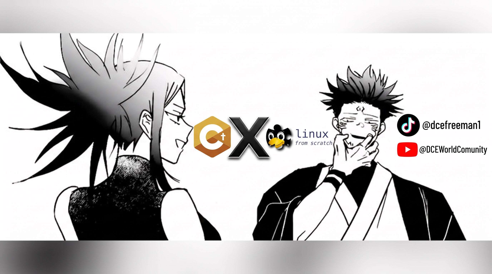

  <!-- BANNER PRINCIPAL ANIME & TECH -->
  

    

  <!-- TYPING SVG ANIMATION -->
  

   

  <!-- REDES SOCIALES & BADGES OFICIALES -->
  

    
    
    
    
    
  

---

### ⚡ Acerca de mí

¡Hola! Soy **Lettiori** (conocido como **DCE**), fundador y desarrollador principal de **DCE Studios** & **DCE Gaming**. Me dedico a crear herramientas avanzadas para la comunidad de videojuegos, utilidades de sistemas en Linux y software interactivo con alto rendimiento.

* 🎮 **Proyecto Principal:** [DCE Mods Loader [Versus]](https://github.com/DCE-21k69/DCE-MODLOADER-VERSUS.L4D2) — Suite moderna para jugar Versus con mods en Left 4 Dead 2 sin riesgo VAC, con compilador nativo de sprays VTF/VMT y empaquetador VPK.
* 🦀 **Sistemas & Low-Level:** Desarrollando [Codex WM](https://github.com/DCE-21k69/codex-wm) (Window Manager en Rust) y scripts de optimización para entornos Linux (Void Linux & LFS).
* 🕹️ **Game Dev:** Proyectos interactivos en **Godot Engine** ([AO Project](https://github.com/DCE-21k69/AO-Project-TDA)).
* 📺 **Anime & Media:** Apasionado del anime, manga y creador de [DCE Anime](https://github.com/DCE-21k69/DCE-ANIME).

---

### 💻 Stack Tecnológico & Ecosistema

  

  
  
  
  

---

### 🔥 Proyectos Destacados

<table>
  <tr>
    <td width="50%" valign="top">
      <h3>🎮 <a href="https://github.com/DCE-21k69/DCE-MODLOADER-VERSUS.L4D2">DCE Mods Loader [Versus]</a></h3>
      
Suite multiplataforma de mods para Left 4 Dead 2. Permite usar mods de la Workshop en modo Enfrentamiento (Versus) sin baneo VAC. Incluye <strong>Spray Studio</strong>, <strong>Spray Catcher</strong> y auto-actualizador.

      
<code>Python</code> • <code>Source VTF/VPK</code> • <code>Flatpak / Windows</code>

    </td>
    <td width="50%" valign="top">
      <h3>🦀 <a href="https://github.com/DCE-21k69/codex-wm">Codex WM</a></h3>
      
Window Manager minimalista, hiper-veloz y ultra personalizable construido en <strong>Rust</strong> para sistemas Linux.

      
<code>Rust</code> • <code>X11 / Wayland</code> • <code>Linux Architecture</code>

    </td>
  </tr>
  <tr>
    <td width="50%" valign="top">
      <h3>🐧 <a href="https://github.com/DCE-21k69/AlphaX-Linux">AlphaX Linux / Base-AlphaX</a></h3>
      
Configuraciones de sistema, automatización y scripts de optimización basados en Void Linux y Linux From Scratch (LFS).

      
<code>Bash</code> • <code>Shell</code> • <code>System Init</code>

    </td>
    <td width="50%" valign="top">
      <h3>🕹️ <a href="https://github.com/DCE-21k69/AO-Project-TDA">AO Project</a></h3>
      
Proyecto de videojuego desarrollado en <strong>Godot Engine</strong> con mecánicas tácticas, shaders personalizados y combates dinámicos.

      
<code>Godot</code> • <code>GDScript</code> • <code>Game Design</code>

    </td>
  </tr>
  <tr>
    <td width="50%" valign="top">
      <h3>🌐 <a href="https://github.com/DCE-21k69/DCE-GAMING-WED">DCE Gaming Web & Servidores</a></h3>
      
Portal web oficial de la comunidad y red de servidores dedicados de videojuegos con infraestructura propia.

      
<code>HTML5/CSS3</code> • <code>JavaScript</code> • <code>Server Management</code>

    </td>
    <td width="50%" valign="top">
      <h3>🎬 <a href="https://github.com/DCE-21k69/DCE-ANIME">DCE Anime & API</a></h3>
      
Plataforma web rápida, moderna y libre de anuncios para streaming y catálogo de anime.

      
<code>JavaScript</code> • <code>Node.js</code> • <code>Web Streaming</code>

    </td>
  </tr>
</table>

---

### 📊 Estadísticas de GitHub

  
  

  

---

  
<i>"El software bien hecho no necesita presumir; simplemente funciona rápido, limpio y sin límites."</i> ⚡

  
<strong>DCE STUDIOS © 2026</strong>

